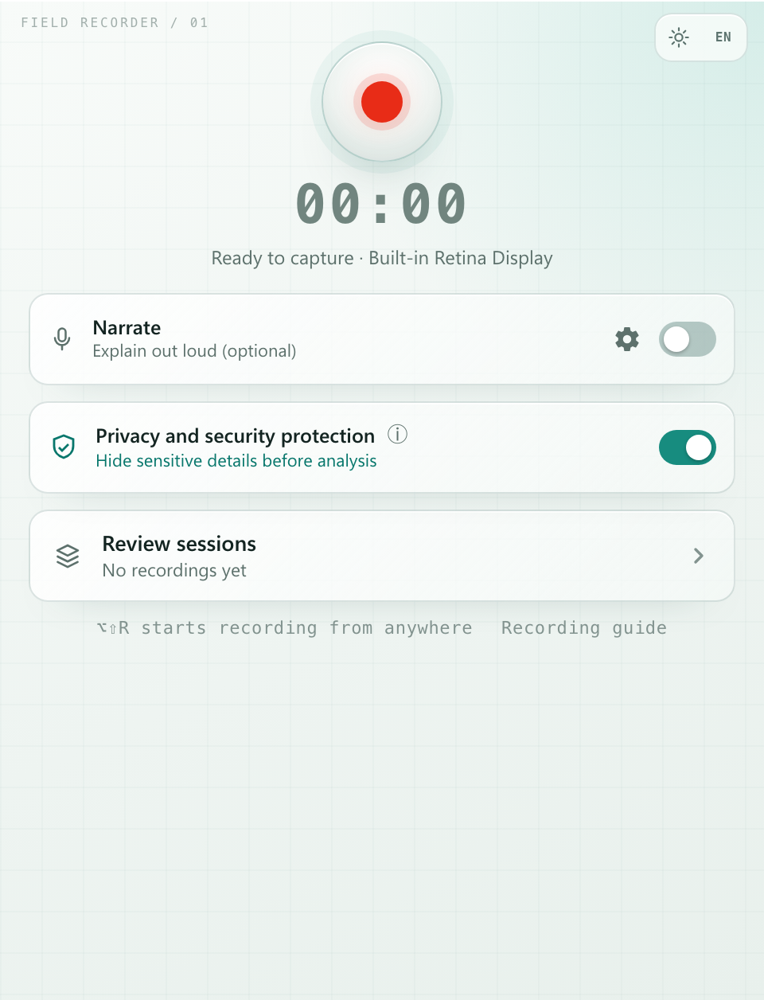
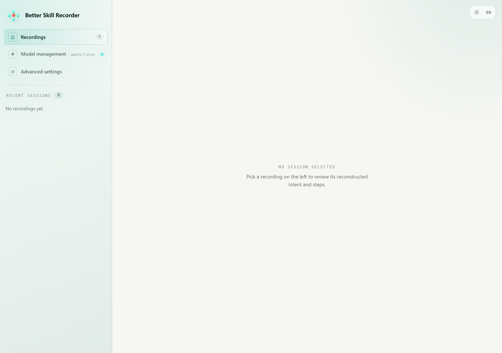

# Better Skill Recorder

[English](README.md) · [简体中文](README.zh-CN.md)

**Preview V0.1.0 · Apple Silicon · Unsigned Preview**

[项目主页 / Website](https://songhonglei.github.io/better-skill-recorder/) ·
[下载预览版 / Download](https://github.com/Songhonglei/better-skill-recorder/releases/tag/preview-v0.1.0) ·
[中文安装与使用说明](docs/GETTING_STARTED.zh-CN.md) ·
[高级设置](docs/ADVANCED_SETTINGS.md)

[Install with an agent](docs/AGENT_INSTALL.md) — copy a prompt for verified download,
checksum validation and installation, with user-controlled permissions

No Node.js, npm, or GitHub Copilot installation is required for packaged-app users.
Bring your own compatible model endpoint and API key. This preview has not yet completed
an independent clean-Mac acceptance test; begin with non-sensitive sample recordings.

Record your screen, talk through the task, and let AI turn it into a reusable Skill.
Review the generated steps and export a share-safe or personal package for your agent.

Better Skill Recorder captures screen activity, app and window changes, browser context,
clipboard previews, and optional narration. A user-selected OpenAI-compatible model then
reconstructs the intent and ordered steps. You can review the result before exporting it
as a share-safe Skill or a personal Skill containing local configuration.

> Current platform: **macOS on Apple Silicon (ARM64)**. Windows, Linux, and Intel Mac
> installers are not yet supported.

<p align="center">
  
  &nbsp;&nbsp;
  
</p>

Current Preview V0.1.0 renderer, captured with synthetic demo settings and an empty
recording library. No personal recordings or API keys are included. See the
[interface gallery](docs/SCREENSHOTS.md) for model management and advanced settings.

## Highlights

- Record a real workflow instead of writing a procedure from scratch
- Analyze with your own OpenAI-compatible endpoint and API key
- Configure verified presets or any compatible model ID
- Keep API keys encrypted by the macOS credential store
- Run English OCR locally before visual data is sent to the selected model
- Automatically move expired recordings to Trash (30 days by default, configurable)
- Configure the minimum recording duration, audio size limit and global shortcut
- Export share-safe Skills without secrets or machine-specific configuration
- Export personal Skills that retain local defaults when explicitly requested
- Generate Skills without coupling them to OpenClaw, Codex, Claude Code, or another host

## How it works

1. **Record** — start a recording and complete the task normally
2. **Analyze** — review the locally collected timeline and send selected, redacted material
   to your configured model
3. **Edit** — correct the intent and ordered steps
4. **Export** — create a share-safe or personal Skill package

Recording and local redaction do not contact a model. Network requests begin only when
you analyze, generate, test a model connection, or download the optional narration model.
Turning off visual analysis prevents screenshots from being sent to the model.

## Install the unsigned preview

GitHub preview binaries are currently **ad-hoc signed and not notarized by Apple**. macOS
will warn that it cannot verify the developer or check the app through Apple's notarization
service. Install only a release downloaded from this repository and verify its SHA-256
checksum first.

1. Download the `macOS-arm64` ZIP and `SHA256SUMS.txt` from the
   [Preview V0.1.0 release](https://github.com/Songhonglei/better-skill-recorder/releases/tag/preview-v0.1.0)
2. Verify the download:

   ```bash
   shasum -a 256 "/path/to/Better-Skill-Recorder-0.1.0-preview.1-macOS-arm64-unsigned-preview.zip"
   ```

3. Confirm the output matches the value published in `SHA256SUMS.txt`
4. Unzip the archive and move **Better Skill Recorder.app** to `/Applications`
5. Try to open the app once
6. If macOS blocks it, open **System Settings → Privacy & Security**, scroll to
   **Security**, choose **Open Anyway**, then confirm **Open**

Do not disable Gatekeeper globally and do not run unverified `xattr` commands copied from
third-party sites. See [INSTALL.md](INSTALL.md) for permissions, updates, and uninstall.

## First run

1. Grant Screen & System Audio Recording when macOS requests it
2. Open **Model management**
3. Select a preset or enable **Custom model** and enter its exact model ID
4. Enter the provider BaseURL and API key
5. Choose whether visual analysis is enabled
6. Test the connection, then save and enable the configuration

The endpoint must implement OpenAI-compatible Chat Completions, function/tool calls, and
multi-turn tool execution. Visual analysis additionally requires inline image input.
Configuration details are in
[docs/MODEL_CONFIGURATION.md](docs/MODEL_CONFIGURATION.md).

## Privacy boundary

Better Skill Recorder may capture:

- active application and window titles
- the active browser URL on macOS
- screen video and selected snapshots
- short clipboard previews
- optional microphone narration

English OCR and sensitive-data heuristics run locally. They reduce exposure but cannot
guarantee that every secret or personal detail will be detected. Review the recording and
avoid displaying, typing, copying, or narrating passwords, tokens, private keys, and other
confidential data.

When you choose **Analyze**, selected event data, narration text, and—when visual analysis
is enabled—redacted screenshots are sent to the endpoint you configured. The project does
not provide or proxy that model service.

## Develop from source

Requirements:

- Apple Silicon Mac
- Node.js `>=24.19.0 <25`
- npm `>=11.17.0`

```bash
git clone https://github.com/Songhonglei/better-skill-recorder.git
cd better-skill-recorder
npm ci --ignore-scripts=false --dangerously-allow-all-scripts=false --strict-allow-scripts
npm run assets:prepare
npm run compliance:licenses
npm run dev
```

Useful checks:

```bash
npm run check:lockfile
npm run typecheck
npm run typecheck:evals
npm test
npm run build
```

## Documentation

- [INSTALL.md](INSTALL.md) — unsigned preview installation and removal
- [RELEASING.md](RELEASING.md) — maintainer release checklist
- [Model configuration](docs/MODEL_CONFIGURATION.md) — endpoint, presets, and storage
- [Provider validation](docs/OPENAI_COMPATIBLE_VALIDATION.md) — compatibility boundaries
- [Third-party notices](THIRD-PARTY-NOTICES.md) — bundled components and licenses
- [Security policy](SECURITY.md) — private vulnerability reporting
- [Support](SUPPORT.md) — help and issue scope

## Contributing

Contributions are welcome. Read [CONTRIBUTING.md](CONTRIBUTING.md) and follow the
[Code of Conduct](CODE_OF_CONDUCT.md). Do not include recordings, credentials, model keys,
or third-party assets without redistribution permission.

## License and attribution

The project is available under the [MIT License](LICENSE). It is based on Microsoft's
original Skill Recorder project and includes substantial independent modifications.
Microsoft does not sponsor or support this fork.

Upstream: [microsoft/skill-recorder](https://github.com/microsoft/skill-recorder)
