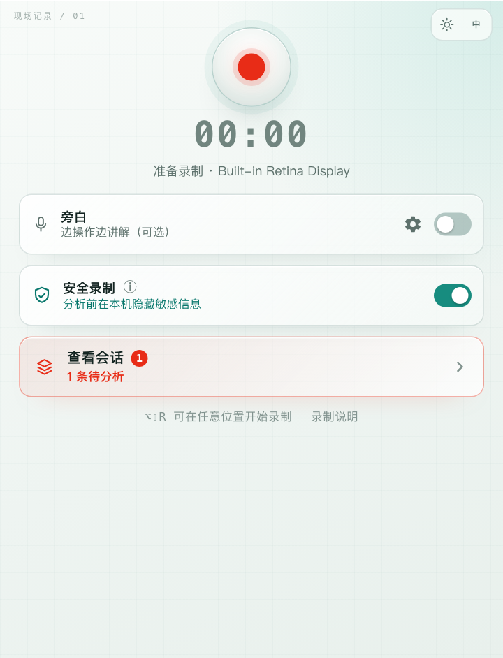
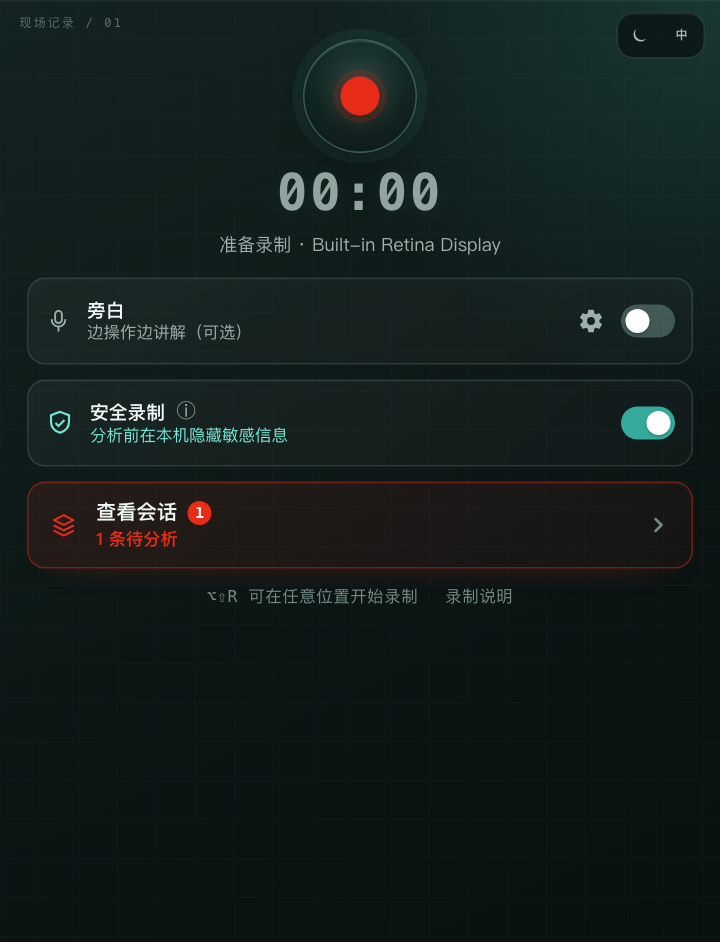
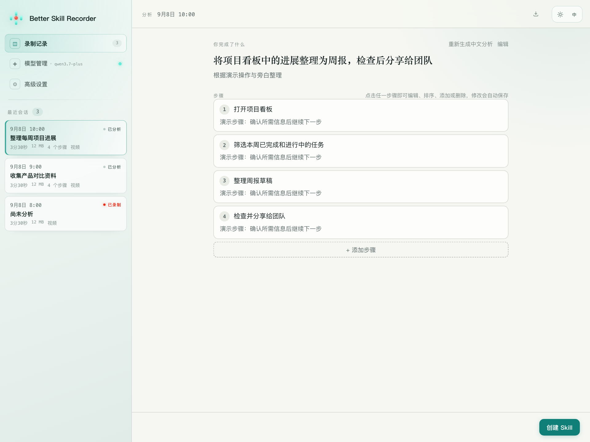
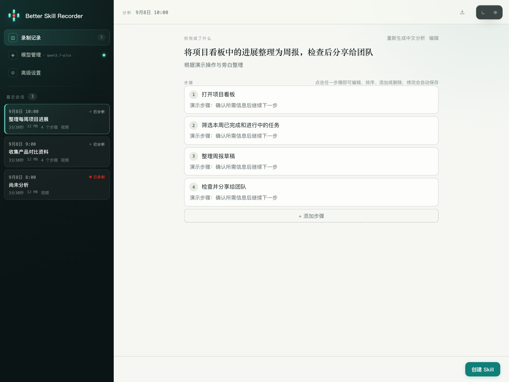
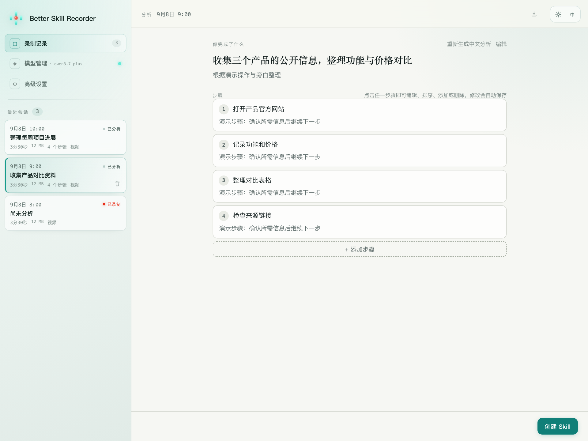
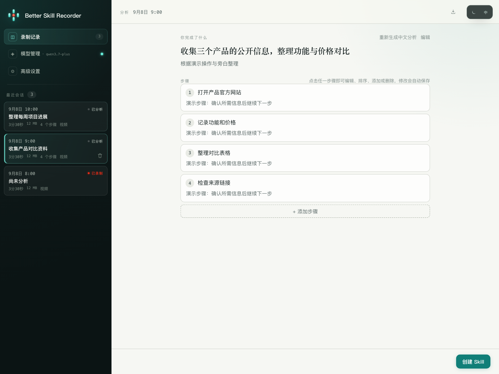
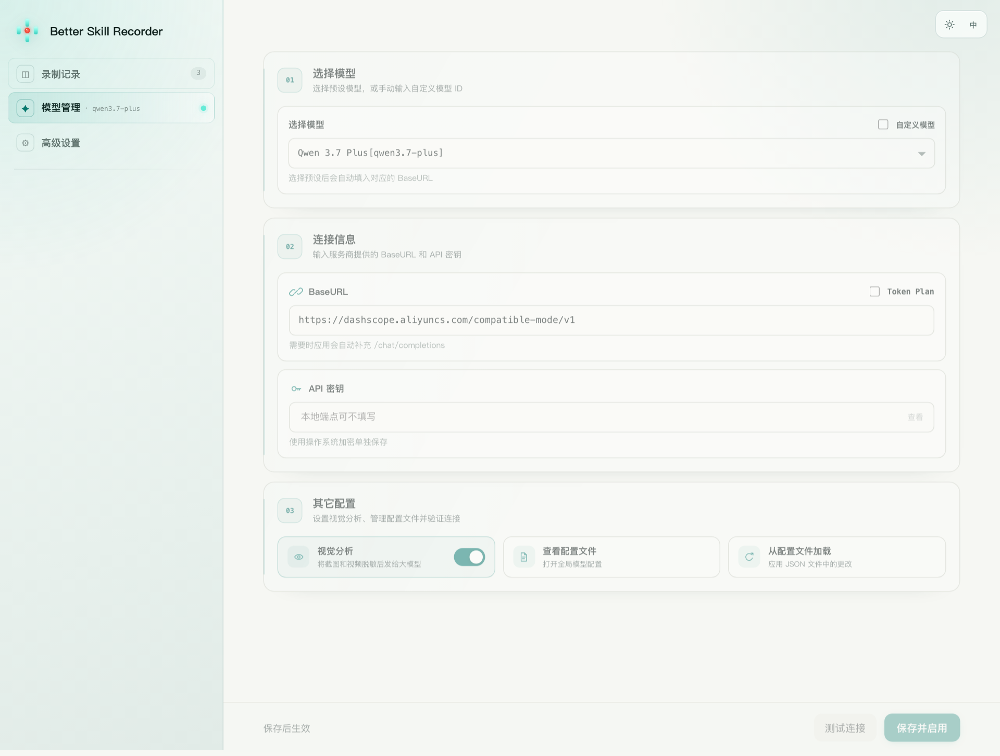
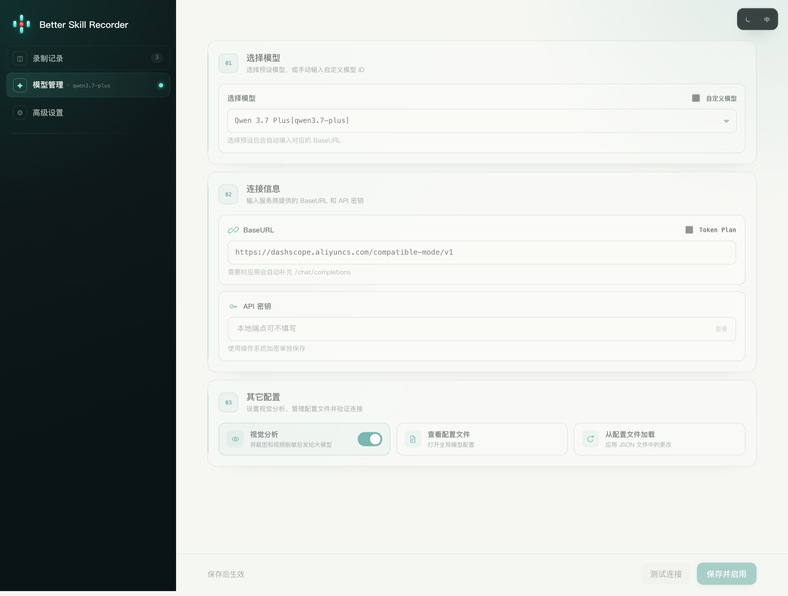
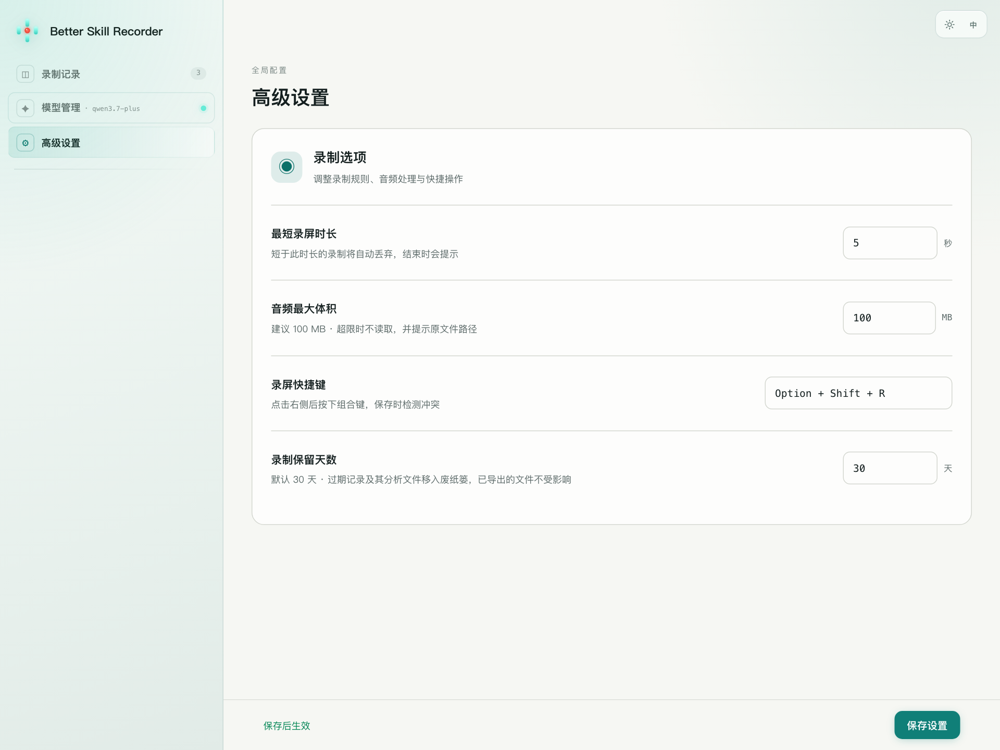
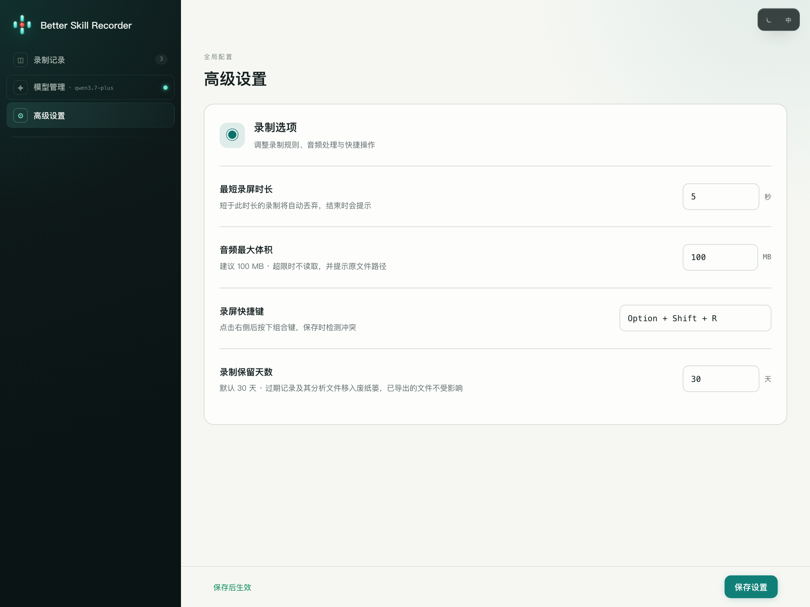

# Better Skill Recorder

[English](README.md) · 简体中文

**录屏配上旁白，让 AI 帮你整理步骤、生成 Skill**

[项目主页](https://songhonglei.github.io/better-skill-recorder/) · [下载 Preview V0.1.0](https://github.com/Songhonglei/better-skill-recorder/releases/tag/preview-v0.1.0) · [安装与使用](docs/GETTING_STARTED.zh-CN.md) · [Agent 安装提示词](docs/AGENT_INSTALL.md)

无需从零编写 Skill：演示一次任务，可选旁白解释意图，使用自己的模型分析，检查确认后导出给智能体使用

## 主要功能

- 本地录屏与可选旁白，按 Option + Shift + R 开始
- 安全录制：发送前尝试本地脱敏，保护可能漏检或误遮挡，不是绝对保证
- 自定义 LLM：OpenAI 兼容 BaseURL、模型 ID、API 密钥，支持预设与 Qwen Token Plan 地址联动
- 一键导出：分享安全版或保留本地配置的个人版 Skill，分享前人工复核
- 自动清理：默认保留 30 天，满足空闲条件后将过期记录移入废纸篓
- 高级设置：最短录制时长、音频体积上限、快捷键与禁用名单
- 明暗主题、中英文界面、MIT 开源

## 界面预览

<table>
<tr>
<td width="50%" align="center"> 录制 · 浅色</td>
<td width="50%" align="center"> 录制 · 深色</td>
</tr>
<tr>
<td width="50%" align="center"> 录制记录 · 周报示例 · 浅色</td>
<td width="50%" align="center"> 录制记录 · 周报示例 · 深色</td>
</tr>
<tr>
<td width="50%" align="center"> 录制记录 · 产品对比 · 浅色</td>
<td width="50%" align="center"> 录制记录 · 产品对比 · 深色</td>
</tr>
<tr>
<td width="50%" align="center"> 模型管理 · 浅色</td>
<td width="50%" align="center"> 模型管理 · 深色</td>
</tr>
<tr>
<td width="50%" align="center"> 高级设置 · 浅色</td>
<td width="50%" align="center"> 高级设置 · 深色</td>
</tr>
</table>

Preview V0.1.0 浅色与深色界面，点击图片可查看大图
录制记录和分析结果均为虚构示例，使用真实界面渲染，不含个人数据，也不代表模型实测结果
[英文画廊与截图生成说明](docs/SCREENSHOTS.md)

## 安装与开始使用

当前支持 Apple Silicon Mac，Intel Mac / Windows / Linux 安装包暂未支持。普通用户无需安装 Node、npm 或 GitHub Copilot

1. 从 Release 下载 ZIP 和 SHA256SUMS.txt，校验后解压并拖入「应用程序」
2. 当前为未经 Apple 公证的预览版，按[安装指南](docs/GETTING_STARTED.zh-CN.md)手动放行并授权录屏，之后重启 App
3. 在模型管理填写服务商信息，测试连接并保存；模型调用费用由所配置的服务商收取
4. 先录制一个 20–30 秒、不含敏感信息的小任务，再分析、检查和导出 Skill

也可以把 [Agent 安装提示词](docs/AGENT_INSTALL.md)交给具备本地操作能力的 Agent。系统权限和密钥由你自行确认，不会绕过安全控制

## 数据与使用边界

录制和脱敏在本机完成；分析与生成会发送相关内容到你配置的模型服务。关闭视觉分析仅阻止图片发送，不阻止分析文本发送

定时 Skill 是文件包，需由支持该能力的智能体导入运行，App 不托管定时任务。没有自动更新，不录制系统音频，旁白首次使用可能下载本地转写模型

本地数据目录：`~/Library/Application Support/skill-recorder`。不要公开录制数据、个人配置或 API 密钥

## 文档与参与

- [安装与使用](docs/GETTING_STARTED.zh-CN.md)
- [模型配置](docs/MODEL_CONFIGURATION.md)
- [高级设置](docs/ADVANCED_SETTINGS.md)
- [问题反馈](https://github.com/Songhonglei/better-skill-recorder/issues)
- [源码开发](README.md#develop-from-source) · [贡献指南](CONTRIBUTING.md) · [第三方声明](THIRD-PARTY-NOTICES.md)

## 开源与致谢

遵循 [MIT License](LICENSE)，基于微软开源项目 [microsoft/skill-recorder](https://github.com/microsoft/skill-recorder)独立开发与维护，与微软无隶属或赞助关系
