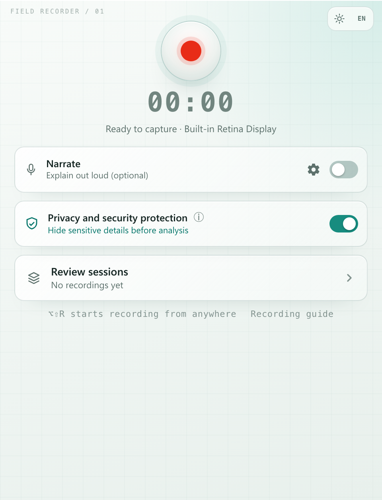
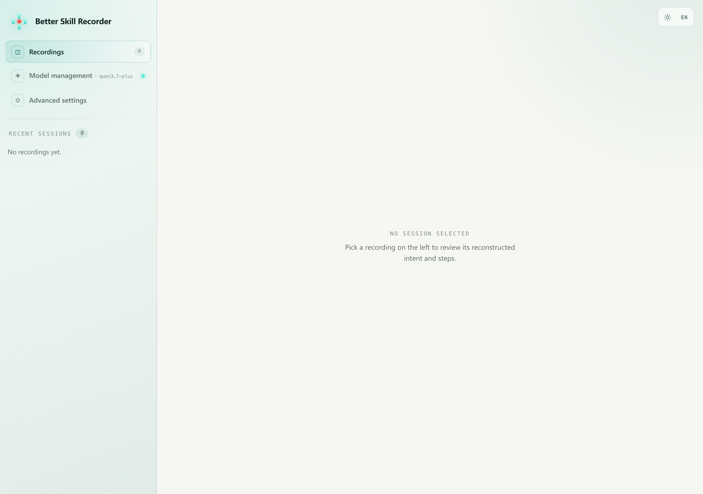
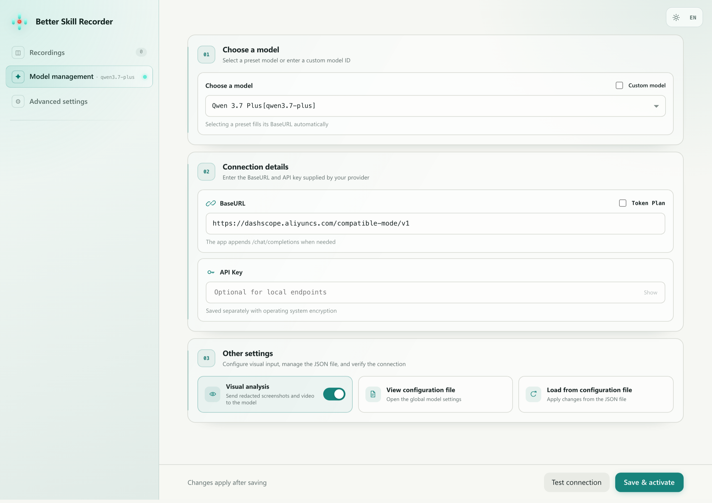
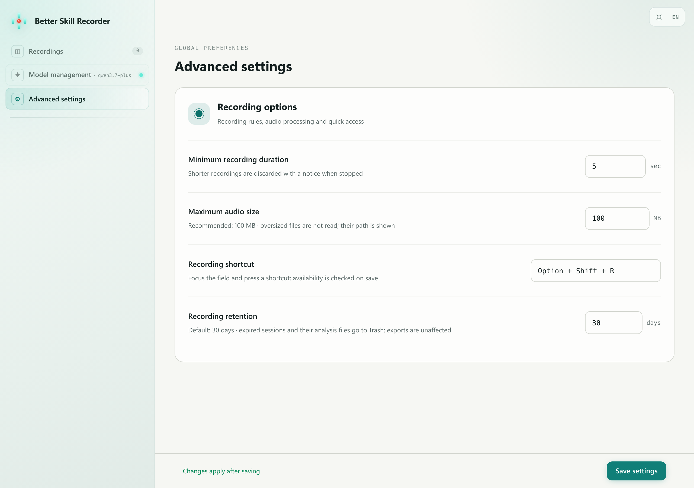

# Current interface / 当前界面

Updated 2026-09-08 for Preview V0.1.0. These are the current production renderer with
synthetic demo settings and an empty session library, not screenshots of personal data.
They document the UI, not an end-to-end screen-capture or model-compatibility test.

截图为当前生产界面，使用虚构示例配置与空会话列表，不含个人录制、密钥或真实路径。
页面内容与控件来自应用本身，截图不代表端到端录制或模型兼容性测试。

## Recorder / 录制

## Recordings / 录制记录

## Model management / 模型管理

## Advanced settings / 高级设置

## Reproduce / 重新生成

Build the production renderer with `npm run build:vite`, serve `dist` on localhost:8766,
then run `python3 scripts/capture-doc-images.py` with Playwright and Chromium installed.
The script provides a synthetic IPC bridge, never connects to Electron or model services,
and uses default settings rather than a maintainer's saved preferences.
